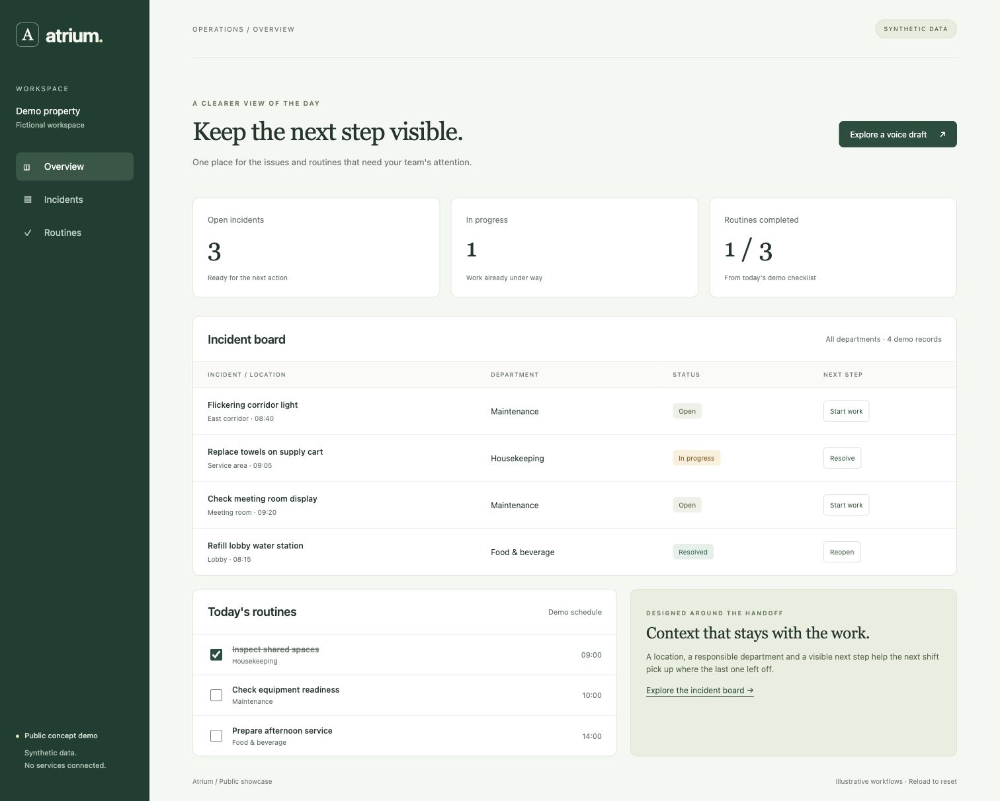
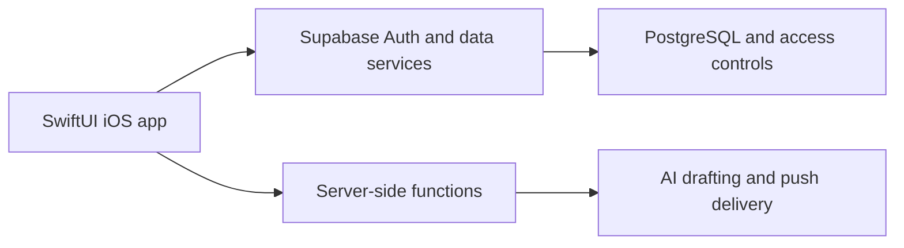

# Atrium

Hotel operations software for reporting incidents, coordinating departments and following work through to completion.

[**Live demo**](https://javierprietoprogram.github.io/atrium-showcase/) · [Public website](https://www.atriumforhotels.com/) · [Product](docs/product.md) · [Architecture](docs/architecture.md) · [Development notes](docs/development-notes.md)



A maintenance issue often crosses several teams. When the report, responsibility and resolution live in separate conversations, the next shift has to reconstruct what happened. Atrium gives that work a shared place: a location, a responsible department, a status and a record of progress.

## What I work on

My role combines **product definition and development**: translating hotel operational needs into requirements, building the iOS experience and its backend workflows, and connecting reporting, recurring work and operational data. The project includes voice-assisted incident drafting, where AI prepares editable information and a person reviews it before submission.

Representative areas of work:

- **Incident coordination:** reporting, department responsibilities, assignment, progress and manager review.
- **Recurring operations:** scheduled routines and their individual occurrences.
- **Operational visibility:** dashboards and descriptive analytics from recorded work.
- **AI and automation:** voice-to-draft reporting, notifications and data workflows.

## Try the public demo

Try the [live demo](https://javierprietoprogram.github.io/atrium-showcase/) or open [`demo/index.html`](demo/index.html) in a browser. No install, account or network connection is required. Or serve it locally:

```sh
python3 -m http.server 8000 --directory demo
```

Then open `http://localhost:8000`. Filter incidents, advance an incident's status, complete a routine, and inspect a fixed voice-draft example. Changes exist only in memory; reload to reset.

The browser demo is a small recreation built for this repository. **Every location, record and number is synthetic.** It is not a production screenshot or an implementation of Atrium's business rules.

## Technical choices

The private application uses **Swift, SwiftUI, Supabase, PostgreSQL, TypeScript/Deno Edge Functions and OpenAI APIs**. This public demo uses only HTML, CSS and JavaScript.

- Native views are separated from repository interfaces and remote data models.
- Authentication and database access controls establish scope beyond the UI.
- Backend functions handle privileged integrations; provider credentials stay server-side.
- AI produces a reviewable draft rather than silently creating operational records.
- Recorded activity supports descriptive analytics; this showcase makes no forecasting claims.



See [architecture](docs/architecture.md) for boundaries and [development notes](docs/development-notes.md) for implementation tradeoffs.

## Scope and reuse

This is a public showcase created independently from scratch. Production code, infrastructure configuration, data, schemas and history remain private. The MIT license covers the material in this repository only; it grants no rights to the private Atrium product or its branding.
