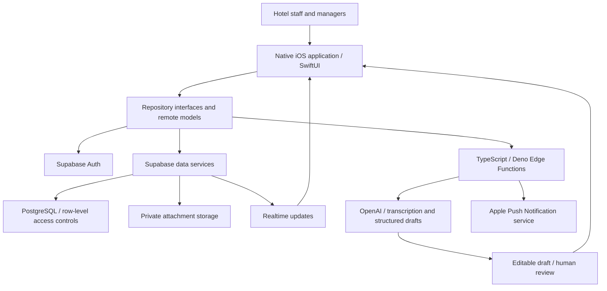

# Architecture

This describes technologies and broad boundaries supported by the private source repository. It is not an infrastructure inventory or an operational runbook. No live deployment was inspected for this showcase.

## Frontend

The application is native iOS, built with Swift and SwiftUI. Observable state, domain models and repository interfaces separate rendering from remote operations. The public browser demo is independently authored and does not use the iOS source or its data models.

## Backend and data

Supabase provides authentication, PostgreSQL-backed data access, storage and realtime capabilities. Database migrations and server-side operations support scoped workflows. Row-level controls and authenticated operations enforce access beyond what the interface displays. Exact tables, policies, queries, identifiers and workflow rules are omitted.

## Authentication

The iOS client uses Supabase Auth sessions. Access depends on hotel membership and role context. The demo has no login and does not recreate authentication configuration, authorization policies or account administration.

## Integrations and AI

TypeScript/Deno Edge Functions handle server-side workflows. The repository includes an Apple push delivery integration and an OpenAI-backed voice reporting path: transcription, structured drafting and user review. Manual reporting remains available. The demo's voice example is hardcoded; it neither records audio nor invokes a model.

## Deployment boundaries

The codebase targets a native iOS client and a Supabase-hosted backend, with server-side functions making external integration calls. The source includes Xcode UI checks and standalone validation tools. This is a description of the software structure, not a claim about current release or App Store availability. No project references, environments, deployment addresses or release configuration are published.

## Public demo

The demo is static HTML/CSS/JavaScript, with in-memory synthetic records and no dependencies. Its only runtime resources are the static files in `demo/`. It has no backend, analytics, cookies, external fonts or persistence.
